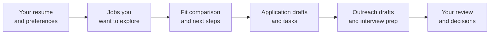

<div align="center">

# JobSSS

**Job Search Shape Send**

Your job search, organized with your AI agent.

Find roles that fit, prepare applications from your real experience,
and keep track of what comes next — in a workspace on your machine.

[Get started](#get-started) · [What you get](#what-you-get) · [How it works](#how-it-works) · [Architecture](#architecture)

</div>

## What you get

| In your search | JobSSS helps you |
| --- | --- |
| **Know your strengths** | Build a profile from your resume and collect experience to support your applications. |
| **Choose where to apply** | Import job descriptions or public job links, compare fit, and see the reasons behind each score. |
| **Prepare your application** | Inspect the posting and questions, then edit tailored resume content and answers in one saved application review. |
| **Stage for final review** | With your authorization and supported host browser capability, fill the current in-app application tab and stop before submission. |
| **Keep things moving** | Organize roles, application preparation, tasks, and your review queue in one place. |
| **Plan your outreach** | Map your contacts and draft messages for you to review and send. |
| **Get ready for interviews** | Prepare STAR stories, practice questions, and identify gaps. |

JobSSS is a plugin for an AI agent. Your agent handles the conversation;
JobSSS keeps the job-search records and documents. The core workflow needs no
API key. Your agent host has its own model and account requirements.

## Get started

You need **Node.js 22 or newer** and an agent host. Run these commands in the
terminal where you use that host; if you use it in WSL, use your WSL terminal.

### Run with npx

```bash
npx --package=github:lpbangun/jobsss jobsss init
```

### Or install the CLI globally

```bash
npm install -g github:lpbangun/jobsss
jobsss init
```

These commands fetch the CLI from GitHub and need Git as well as Node.js.
`init` creates `jobsss-workspace/` in your current folder, including a local
runtime, personal data folder, and project configuration for Codex and Claude
Code. Choose a custom folder with `jobsss init my-job-search`. You can use a
new folder or an existing empty folder; its personal data stays inside
`.jobsss/data/` within that workspace.

```bash
cd jobsss-workspace
node jobsss.mjs doctor
codex  # or claude
```

Review your agent's trust prompts and start a fresh chat. This workspace includes
the core JobSSS plugin. For the optional companion stack, use the separate
installation below; its host-managed data folder is separate from this workspace.

### Codex: load the job-search stack

```bash
git clone https://github.com/lpbangun/jobsss.git
cd jobsss
codex plugin marketplace add .
codex plugin add job-search-stack@jobsss-local
```

Start a **new Codex chat** after installation so the plugin loads. The included
stack contains JobSSS, people-finder, and contact-brief. JobSSS works on its own;
the companions add candidate-lead discovery and contact briefs.

This integration has been verified on Windows. See the
[installation guide](INSTALL.md) for other hosts, activation checks, and source
setup, including local source installation.

### Start with one job

Give your agent your resume and a job description, then try:

> Use JobSSS to create my profile from this resume. Compare this job with my
> experience and preferences, explain the fit, and suggest what I should do next.

Then continue with:

- “Inspect this posting and application, ask for missing facts, and prepare one editable review.”
- “Stage the reviewed application in my current in-app browser tab and stop before Submit.”
- “Prepare a tailored resume and cover letter for this role.”
- “Show my pipeline and the tasks I should work on next.”
- “Draft an outreach message for me to review.”
- “Help me prepare interview stories for this role.”

Review the drafts before using them. Resume PDF export needs a local Chrome or
Edge browser available to the runtime; the installation guide covers setup.

## How it works



Your profile, jobs, documents, and tasks stay in the plugin's local data
folder and remain available when you restart. Optional public job intake uses
the network. Information shared in chat follows your agent host's and model
provider's data policies.

JobSSS drafts materials and messages. **You review, send, and submit.**
Resume proof points and interview stories need your verification. Application
review and staging approval use the trusted local review page;
other human-only decisions use the trusted CLI described in the
[technical reference](TECHNICAL.md#human-only-authority).

## Review and stage one application

1. **Inspect the actual posting and form.** Your agent records the questions, required and user-expected fields, options, character limits and upload constraints. Inaccessible pages or unknown requirements stay unresolved.
2. **Ground the application.** The agent uses the selected profile's canonical evidence and standing decisions, asks for missing facts, and drafts tailored answers and resume content. It must not invent qualifications, eligibility, compensation preferences or consent.
3. **Edit one saved review.** The local page is the application's source of truth for the posting, requirements, confirmed facts, answers and resume. Your edits survive regeneration and reopening. The generation button requests work from the host agent; it does not call a model itself.
4. **Regenerate and review exact artifacts.** Resume edits regenerate the actual PDF. Every applicable independent quality criterion must score **at least 9/10**, with no averaging; unknown evidence or a lower score blocks approval. Inspect the final PDF pixels and answers, confirm factual accuracy, then approve that exact revision. Later edits invalidate the artifact binding, quality review, approval and staging receipt.
5. **Dispatch actual staging.** Explicitly request staging after review. The default is the current **Codex/ChatGPT desktop in-app browser**, using the host's supported browser capability. The host fills the reviewed values, replaces the resume upload and checks actual field/file read-back against the approved revision. It never silently opens external Chrome. Preparing a manifest alone does not fill a form.
6. **Inspect and submit yourself.** Check the staged form and handle signatures, privacy acknowledgments and consent/waiver decisions. **Submit is a separate user action.** Successful staging does not establish that the ATS will accept final submission.

After the agent creates the review, keep using the same data directory and the returned profile/job IDs. In an initialized workspace:

```bash
node jobsss.mjs doctor
node jobsss.mjs review --data .jobsss/data --profile <profile-id> --job <job-id>
```

The second command starts a loopback server and prints a session-specific `reviewUrl`; open that URL in the in-app browser and keep the server running while editing. The workspace wrapper requires explicit `--data` for `review`. For a source checkout, use `./bin/jobsss review --data <configured-data-dir> --profile <profile-id> --job <job-id>`. An installed plugin must use its existing host-provided `PLUGIN_DATA`; do not create a second store for review. Local Chrome/Edge is needed for resume PDF rendering, which is separate from employer-site browser access.

Keep the review and application tab in the **same local task and host**. Use the existing populated tab; a new tab at the same URL can be blank. A queued cross-host attachment is not a verified visible handoff. If the owner tab is not exposed to the worker's supported capability, staging must continue on the owner host or be handed off explicitly.

The runtime accepts a host browser adapter through `startMcp({hostBrowserAdapter})`; standalone stdio has no automatic IAB connection and `stage_application` returns `host_browser_required`. The review page's staging button prepares a manifest for the host; the host must execute staging and record verified read-back.

Synthetic tests cover editing, reopening, validation, replacement uploads and stopping before submission. Manual local IAB checks verified fields, narratives, a displayed resume filename and arrival at final questions; a complete live MCP-managed receipt and cross-host handoff remain unverified. The site did not expose remote uploaded PDF bytes/hash, so a filename cannot certify those bytes. A WSL renderer attempt timed out; separate Windows rendering succeeded. Missing rendering or read-back evidence must remain explicit. See the [application-review workflow and limitations](docs/APPLICATION_REVIEW.md).

## Architecture

The full architecture flow is preserved below, including the agent host,
bundled runtime, local storage, human decisions, and optional companions.

<p align="center">
  
</p>

The agent calls JobSSS tools; the bundled runtime manages the local workspace.
The host provides the data folder (`PLUGIN_DATA`). Application confirmations and
staging approval use the local review page; other human decisions stay on the
trusted local CLI. Browser capability belongs to the host, not the runtime.
Companions pass results through the host and cannot write
JobSSS state directly.

[Architecture details](TECHNICAL.md#architecture) ·
[Diagram source](docs/jobsss-architecture.mmd) ·
[Tool reference](TECHNICAL.md#mcp-tool-reference-57-tools)

## Learn more

| Guide | What's inside |
| --- | --- |
| [Installation](INSTALL.md) | Host setup, requirements, and activation checks. |
| [Technical reference](TECHNICAL.md) | Detailed features, tool contracts, local data, architecture boundaries, and release evidence. |
| [Client compatibility](compat/README.md) | Integration status and host-specific details. |
| [Contributing](AGENTS.md) | Repository conventions and required checks. |

JobSSS is an early release (`0.1.0`). Core job-search workflows are implemented;
host and standalone-platform verification varies. See
[status and limitations](TECHNICAL.md#status-and-limitations) before choosing a
setup.

## License

[MIT](LICENSE). Design attribution is in [NOTICE](NOTICE).
